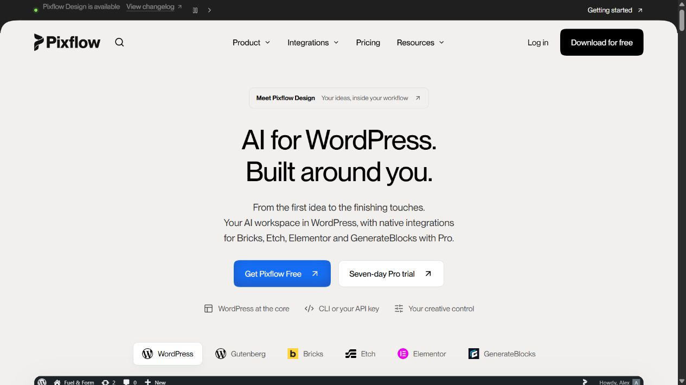

# Pixflow Design

[](https://pixflow.dev)

**An AI assistant inside WordPress. Your site, your choice of agent.**

Work on everyday WordPress tasks and Gutenberg pages through a floating chat panel. Connect your own AI provider, or use a supported local CLI agent through Pixflow Design Bridge.

[Get Pixflow](https://pixflow.dev) · [Documentation](https://docs.pixflow.dev) · [Free and Pro](https://pixflow.dev/free-pro)

Pixflow Design Free works without a Pixflow licence. Connect an API provider using your own credentials, or connect the separately installed Pixflow Design Bridge to use a supported local CLI agent. Provider subscriptions and usage charges are separate from Pixflow.

## What Free includes

- WordPress administration and native Gutenberg editing through the floating agent panel.
- A shared composer and streamed responses, with supported queueing and steering.
- Durable chat history, pagination, working-context compaction, full-chat export and storage reporting.
- Essential AI guidance bundled with the plugin; no resource download is required for onboarding.
- English bundled by default, plus downloadable language packs that apply without a page reload.

Compaction reduces the agent's working context; it does not delete the complete chat history. Existing chats, settings and content retain their saved identifiers across updates.

## Free and Pro

| Capability | Free | Pro add-on |
| --- | --- | --- |
| Everyday WordPress administration and Gutenberg editing | Included | Included through Free |
| API and Local CLI chat, history and export | Included | Included through Free |
| Downloadable interface languages | Included | Included through Free |
| Workspace with organised chats and projects | — | Included |
| Specialist Bricks, Etch and Elementor integrations | — | Included |
| Composio connected apps and premium skills | — | Included |
| Advanced PHP, site-file and direct database tools | — | Included, subject to site permissions |

This repository owns Free, shared UI/runtime contracts and the Bridge toolchain. Pro is maintained as a separate add-on in its own repository.

Free builds without Pro source. Pro consumes the shared interfaces from a pinned core revision. Installing source does not activate Pro: server-owned licence checks still govern premium access. The installed plugin identities remain `pixflow-ai/pixflow-ai.php` and `pixflow-design-pro/pixflow-design-pro.php`.

## Getting started

1. Download Free from [Pixflow](https://pixflow.dev) and install it in WordPress.
2. Activate **Pixflow Design** and open the connection setup.
3. Choose **API** to connect your provider, or **Local CLI** to connect the Bridge and a configured agent on your computer.
4. Open the floating panel and describe what you want to do.

API mode runs without the Bridge. Free requires no Pixflow licence.

See [Pixflow documentation](https://docs.pixflow.dev) for setup and provider guidance. WordPress.org submission is pending; this repository does not claim directory approval.

## Developing Free

Use Node 24 and pnpm 10.33.2. Read [AGENTS.md](AGENTS.md) and the relevant module guidance before changing code.

```powershell
pnpm install --frozen-lockfile
pnpm guard
pnpm typecheck
pnpm wordpress:web
```

WordPress code lives in `wordpress/`; browser code in `apps/web`; the local agent daemon in `apps/daemon`. Shared contracts and UI primitives live in `packages/`. Local lifecycle commands use `pnpm tools-dev`; packaged tooling uses `pnpm tools-pack`. Tests and builds are scoped to their owning package.

To package a development website build without replacing published artifacts:

```powershell
$env:PIXFLOW_DESIGN_PACKAGE_OUTPUT_DIR = Join-Path (Get-Location) '.tmp/free-development'
pnpm wordpress:zip
```

Full premium standalone/Bridge development requires an explicitly configured compatible private checkout through `PIXFLOW_DESIGN_PRO_ROOT`. Follow the Pro repository's pinned-core build instructions for paired builds.

## WordPress.org submission

The directory package is a separate build target. Follow [directory build instructions](wordpress/directory/BUILD.md) and [review notes](wordpress/directory/REVIEW-NOTES.md). It excludes Free's website updater, uses WordPress-provided libraries and includes readable source with build instructions. Do not upload the website ZIP as the directory candidate.

After acceptance, WordPress.org must supply Free's stable distribution and updates. The existing website v2.0.4 packages and updater are preserved while that transition is prepared. Pro retains its separate update channel.

## Licence and attribution

Licensed under [Apache 2.0](LICENSE). Third-party components retain their respective licences, copyrights and attributions; see [THIRD-PARTY-NOTICES.md](THIRD-PARTY-NOTICES.md) and the notices alongside their source.

[Pixflow](https://pixflow.dev) · [Documentation](https://docs.pixflow.dev) · [Free and Pro](https://pixflow.dev/free-pro)
