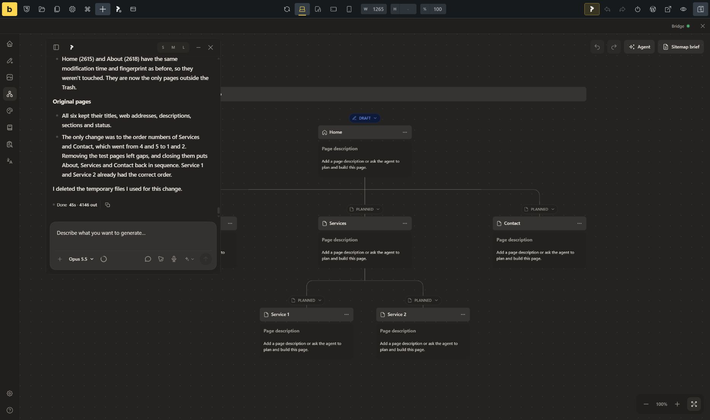

# Sitemap refinement validation

Local WordPress candidate in Chrome, with the original six-page sitemap retained.

Codex acceptance: 12 natural prompts covered planning, descriptions, moving and removing pages, selected WordPress drafts and readback. Initial description and selected-sync defects were fixed and retested.

Claude Code Opus 5.5 / Medium: tagged and untagged descriptions, reparenting, rename, draft creation, multiple page references, generated description prompt, close/reopen and reload. The final draft, two-page comparison, generated description and cleanup runs completed without tool errors. Earlier verification-script mistakes led to clarified tool response contracts and guidance.

Independent baseline comparison after cleanup: six original nodes, zero field differences. Three Claude drafts moved to Trash; existing original WordPress pages unchanged. No release assets published.

Regression coverage includes canonical description normalization, selected-sync validation, stable composer identity/drafts and shared host lifecycle. The lifecycle and description regressions failed before their fixes and passed afterward; this is not a claim that every new test was executed against main.

