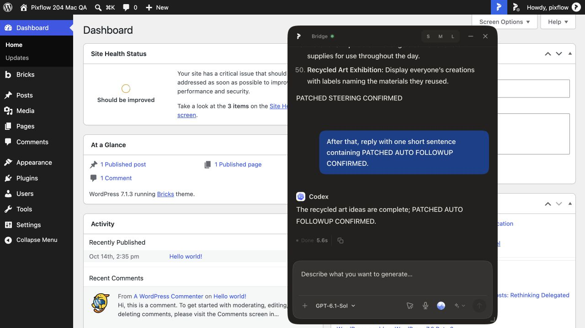
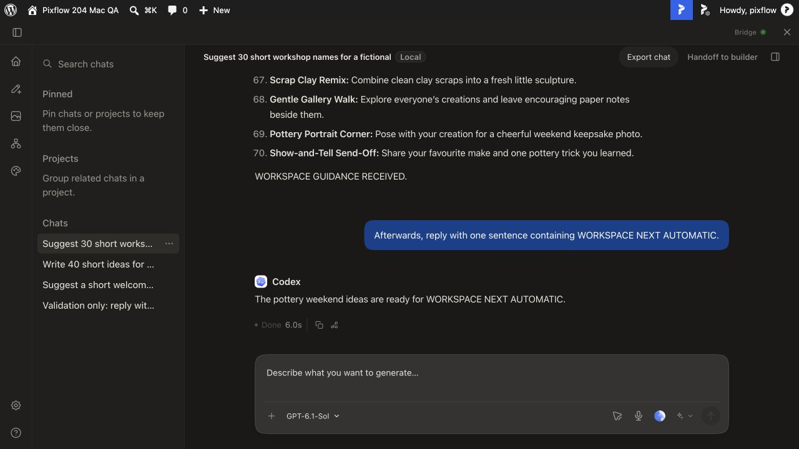
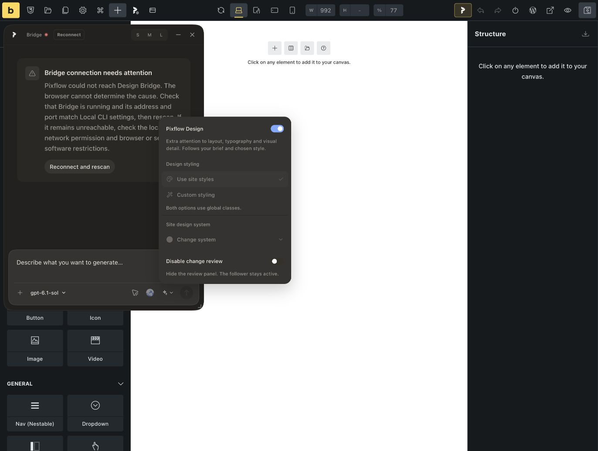
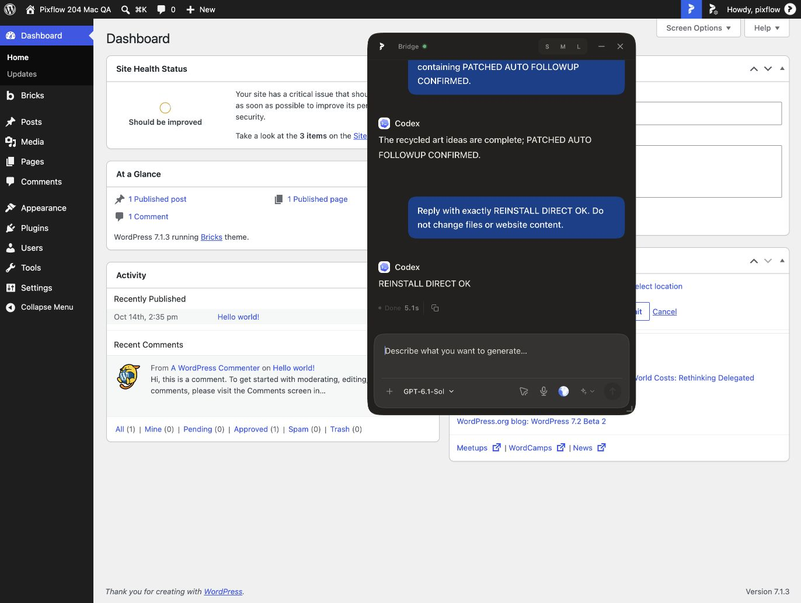

# macOS v2.1.1 acceptance receipt — 28 October 2026

**Partial acceptance; not release approval.** Tested the original trusted LocalWP QA site at the user's request. No Store submission, public installer upload, release promotion, merge, or updater change was made.

## Exact inputs

- Core: `4935eb5e2044da92b19277cd126e63969afd03f4` (clean detached build).
- Private Pro: `99efa4ecb8a9d9b347e621fc9046abc772302ec8` (clean detached build).
- Handoff: `e84855c60d0a5edd6ffea0299a97813c0d8146f4` on `codex/release211-mac-acceptance`.
- macOS 26.5.1 (25F80), arm64; Chrome 156.0.8078.48; Node 24.19.0; pnpm 10.33.2.
- Free and Pro installed and left active at 2.1.1. Ordinary and optional-extension Bridge bundles are 2.1.1, `dev.pixflow.bridge`, product name Pixflow Design Bridge.
- Ordinary and extension installers used separate isolated namespaces. Existing `/Applications/Pixflow Design Bridge.app` 2.0.2 was not replaced. The cloned site's system certificate problem was avoided by using the original trusted QA site, not disabling certificate verification.

## Build and automated checks

| Check | Result |
|---|---|
| Core guard and full typecheck | PASS |
| Focused Core tests | PASS: 202 tests in 10 files |
| Native tests | PASS: 44 passed, one Windows-only skip |
| Packaged registration and packaging integration | PASS: 4 and 3 tests |
| Pro guard, typecheck, contract tests | PASS: 3 contract tests |
| Free/Pro ZIP and ordinary/extension arm64 DMG builds | PASS |
| Pro full web suite | FAIL: 2,208 passed, 7 failed, 28 skipped; 197 passing files, 6 failed, 2 skipped |
| Pro PHP suite | FAIL: seven failing scripts |

All seven web failures also reproduced on the preceding clean pairing: HomeView.prefill, assistant-message-unfinished-todos, missing rememberFloatingExecution VM input, bricksMcpModePolicy source expectation, two missing PixflowOptionalBridgeUnavailableError VM inputs, and Google fonts expectation mismatch. PHP failures also reproduced on that baseline: retired design-template RegistryService input, missing apply_filters in two test stubs, skill-library-cache assertion, and three linked/private skill-storage scenarios. Baseline reproduction does not waive these gates; fixes and reruns remain required.

## Live acceptance matrix

| Scenario | Result and evidence |
|---|---|
| Direct admin send and streaming | PASS: real Codex response |
| Early reload and completed history recovery | PASS: partial response recovered, then complete 40-item response; no duplicate prompt or persistent Working state |
| Ordinary queued follow-ups | PASS: two successors dispatched automatically in FIFO order, including reload recovery |
| Long direct steering on pinned candidate | FAIL: guidance delivery timed out and paused the next item even after guidance eventually completed; manual Send was required |
| Separate queue-recovery patch | PASS: see patch evidence below; this is not included in pinned Core |
| Pro Workspace send and early reload | PASS: completed 30-name response recovered after reopening the saved chat (16 seconds) |
| Pro Workspace steering, queue and navigation | PASS: guidance transition completed (2m16s); queued marker WORKSPACE NEXT AUTOMATIC started without Send and completed in 6 seconds; navigation/reopen and final reload retained replies |
| Free-only operation | PASS spot check: deactivate Pro, Free direct history remains; Pro Workspace/design tools absent; reactivate Pro successfully |
| Existing legitimate Pro entitlement | PASS for active entitlement; expired/revoked transitions NOT RUN |
| Native Bricks repeated save | PASS: synthetic draft heading saved twice, second value confirmed in stored Bricks data and after reload |
| Manual styling without AI/Bridge | FAIL: with Bridge stopped, Use site styles, Custom styling and Change site design system were disabled; enabled again after reconnect |
| Full Design Your System/profile/variable workflow | NOT RUN to completion; disabled controls block Bridge-independent acceptance |
| Bricks-to-WP/ACF handoff, immediate navigation after Send | NOT RUN; ACF fixture unavailable |
| Review target/pill position, bounded canvas requests/recovery, history conflict | NOT RUN as full scenarios; direct/Workspace reload coverage above is narrower |
| Ordinary stop/start and uninstall/reinstall | PASS through packaging lifecycle CLI; 21/21 runtime files byte-identical before restart; existing direct history restored |
| Fresh request after reinstall | PASS: REINSTALL DIRECT OK, completed 5.1 seconds |
| Actual tray Restart menu, reboot, relocation, upgrade from published installer | NOT RUN; CLI restart is not tray or reboot evidence |
| Installed native registration and repair | PASS: automatic registration on launch, explicit owned unregister, normal launch repairs registration |
| Native origin enforcement without Node on PATH | PASS: framed discover exits 0 for approved origin; wrong origin exits 1 with no stdout |
| Real Chrome first approval, revoke, automatic connection | NOT RUN: exact Store identity material unavailable; native stdio tests do not substitute |
| x64 macOS/Linux/Windows customer installer coverage | NOT RUN on this arm64 Mac |
| Final CI, website/download/updater/changelog/language promotion gates | NOT RUN for final promotion; retain handoff gates |

Workspace used the composer Send action to queue and its Steer action for guidance. The transition displayed a finished initial turn, then the guidance response; this receipt does not assert it stayed inside one provider turn. The default plugin manifest appeared among Workspace files, so text-only prompts are not proof that no bootstrap artifact was created.

## Queue recovery fix and remaining timeout

Separate draft PR [#25](https://github.com/pixflowdev/pixflow-design/pull/25), commit `009e64429`, tracks steering-delivery pauses and clears them only after durable receipts resolve the uncertain delivery. It preserves unrelated Stop/failure/edit pauses and ignores late failure acknowledgements for already-delivered items. Two regressions reproduced before the fix; 33 queue tests, guard, full typecheck and Free bundle build passed after it.

A temporary Free ZIP from that clean patch was installed with the pinned Pro and ordinary Bridge. The steer POST returned HTTP 504 at approximately 30 seconds (`Pixflow Design Bridge upstream request timed out.`). A later durable receipt recovered delivery: PATCHED STEERING CONFIRMED completed in 1m56s, then PATCHED AUTO FOLLOWUP CONFIRMED automatically started and completed in 5.6 seconds without manual Send. Reload during the successor recovered the run. The original pinned Free ZIP was then restored. The queue fix is verified live but unmerged; it does not fix the upstream steering timeout. Investigate the active-message wait in `apps/daemon/src/pixflow/codex-turn.ts` and the gateway timeout in `apps/packaged/src/pixflow-bridge-http.ts` together.

## Native registration and signing

The extension installer registered `dev.pixflow.bridge` with only `chrome-extension://hbnbiboohlelmngadeolikeejamjlbkh/` allowed. The manifest was mode 0600 and persistent launcher mode 0700. The launcher used the installed application with ELECTRON_RUN_AS_NODE and an absolute path with spaces; it did not depend on system Node or a mounted DMG. A minimal-PATH framed discover returned zero sites in the intentionally unpaired extension namespace. Wrong-origin input was rejected.

Registration was removed, recreated by a normal launch, then removed again for cleanup. The extension candidate was uninstalled, the ordinary candidate restarted, and the test native manifest is absent. Unrelated native manifests were untouched. Runtime data was retained.

Both application signatures pass `codesign --verify --deep --strict`. Signing is **ad hoc**, with no TeamIdentifier; stapler found no notarization ticket. This is not Developer ID signing/notarization acceptance. The website needs its explicit 2.1.1 unsigned/ad-hoc disclosure before promotion, as already recorded in the handoff.

## Preservation and final state

Original database and wp-content were backed up before upgrading. Final comparisons retain every original row in posts (8→12), postmeta (3→9), comments (1→1), users (1→1), and Pixflow projects (2→4). Synthetic test chats and a draft Bricks page account for intentional additions; the page remains unpublished. Original WordPress chat tables were empty, so this does not prove migration of legacy WordPress chats. Existing runtime direct history was visibly recovered after reinstall.

Bricks Page editing was temporarily enabled for the draft save test. The complete original Bricks global settings value was restored and compared equal to the backup. Both original-site plugins are active at 2.1.1. The ordinary test Bridge remains running. Private database exports, credentials, licence values, raw runtime files and customer logs are retained locally only and excluded from this receipt.

## Request for the coordinating agent

Per the user's request, add the Store draft's **public manifest key** or installable review-link reference and exact-ID setup instructions to a testing document in the private `pixflowdev/pixflow-design-pro` repository. Return its path and commit in the next handoff. The required ID is `hbnbiboohlelmngadeolikeejamjlbkh`. Keep Store upload output keyless; use the public key only in an isolated test build/profile. No private signing key, token or browser profile belongs in Git. This request is also appended to RELEASE-HANDOFF.md. The coordinating Windows chat was not available in the connected chat inventory, so delivery is through this Git handoff rather than an unrelated chat.

## Artifact checksums

No installer was published or uploaded. These are local candidate artifacts, not approved release assets.

| Artifact | Bytes | SHA256 |
|---|---:|---|
| `pixflow-design-bridge-2.1.1-ordinary-mac-arm64.dmg` | 209933927 | `ed4218b1dc48759bdccb9170c67d3f651b36046acd6d52098408c0ac4d83aa7d` |
| `pixflow-design-bridge-2.1.1-extension-mac-arm64.dmg` | 209940709 | `5f902de64fcb7bc811d905686f413fd5768c3700aa267a98fc67da0c08e99db8` |
| `pixflow-ai-2.1.1.zip` | 2377889 | `425c200e83de6d9504b36556823079306be67d17a228b61e1b834686aafb5aba` |
| `pixflow-design-pro-2.1.1.zip` | 5947317 | `cbbbffbd9b26e5c884ba80c0abe03a8668ca0437c8bfa8769eff92c4b2744724` |

## Screenshots

Synthetic test content only. These establish observed UI outcomes, not coverage for unrun scenarios.

