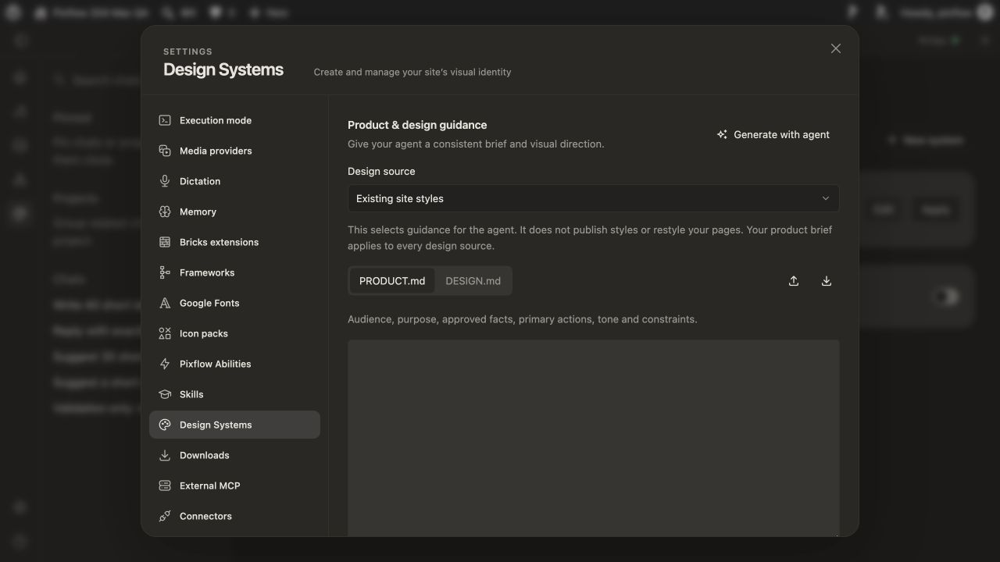
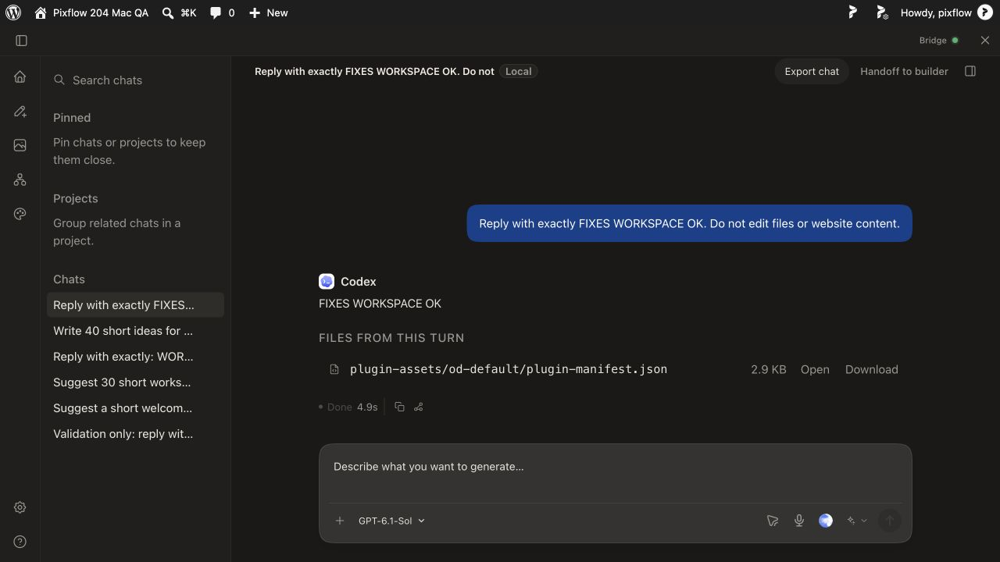

> Latest return: [Mac 2.1.1 production draft handoff](2026-10-28-mac211-production-handoff.md). This older document is historical evidence for its own source pair.

# Mac 2.1.1 acceptance fixes — 28 October 2026

For current status and review/merge instructions, read [the Windows review handoff](2026-10-28-mac211-review-handoff.md). The sections below are chronological evidence; later results supersede earlier pending statements.

Status: implementation and automated regression checks complete. Live Chrome pre-pairing listing, explicit native connection and automatic Bridge-restart recovery pass; remaining acceptance items below are still open. These are local review candidates, not final release approval.

## Exact source and local candidates

Core implementation: `35e5512104a01888491d0fb4456b23a98d628041`.
Pro implementation/build: `590c1b88b531444ba0eb947970003ccdf2c44fca`; subsequent `a4ff3bf4af4f7990ef260a333c5659ca44d8ebb4` only records adapted regression-file checksums in test-lanes.json. Pro pins the Core implementation above. Both fix branches are `codex/mac211-acceptance-fixes`, based on the existing release211 Mac acceptance branches. Earlier receipt results remain historical, not passes for these new binaries.

Built ordinary and native-extension arm64 DMGs locally under `/Users/Shared/Pixflow-211-fixes-35e551`. The extension candidate is installed and running in its isolated namespace. Existing runtime data was copied forward; the original runtime and /Applications installation remain available. New Free/Pro ZIPs are installed on the authorized QA site. No installer upload, release asset replacement, Store submission, merge, live feed, or website deployment.

The loaded test extension directory has updated 1.0.2 files and preserves the exact public manifest key for `hbnbiboohlelmngadeolikeejamjlbkh`. Store output remains keyless. User Chrome Reload/update consent is pending. Update browser and native payload together.

Draft review PRs: [Core #27](https://github.com/pixflowdev/pixflow-design/pull/27), [private Pro #16](https://github.com/pixflowdev/pixflow-design-pro/pull/16). Both are intentionally unmerged.

## Changes

- Discover supported open WordPress admin/builder tabs through extension-authorized metadata inspection, independently of Bridge pairing. Clicking the extension supplies activeTab access; persistent host consent remains explicit. A remembered site stays listed even when offline or its tab is closed.
- Enroll an authorized site through native messaging and the existing Bridge site switch, without browser loopback access or WordPress Reconnect. Validate exact origin, canonical site URL/hash, extension identity and successful Bridge response; page channels cannot forge enrollment controls.
- Reconnect remembered authorized sites at startup, tab changes and a 30-second alarm, including when Bridge starts later. Respect direct-mode opt-out and revoked host access. Reconnection never submits an agent prompt.
- Surface explicit native disconnection as an actionable Workspace error rather than silently falling back and leaving Preparing. Existing runs may still be active; inspect/recover the run without replaying its prompt.
- Quote multiword fallback font families consistently on macOS. Canonicalize the PHP temporary fixture while retaining production path protections.
- Treat unavailable legacy design routes as unsupported rather than failed requests. Manual design-system entry opens the reusable library editor when the legacy route is absent.

## Automated evidence

| Check | Result |
| --- | --- |
| Core guard and full typecheck | Pass |
| Native module typecheck | Pass |
| Native messaging tests | 53 passed, 1 Windows-only skip |
| Workspace SSE + queue tests | 37 passed |
| Bricks MCP/font suite | 64 passed |
| Pro guard and typecheck | Pass |
| Pro repository build contract, final run | 3 passed |
| Full paired Pro web | 2,217 passed, 28 skipped; 203 passed files, 2 skipped files |
| Full paired Pro PHP | Pass |
| Ordinary + extension DMG builds | Pass, arm64 only |
| Free + Pro ZIP build/install | Pass |
| git diff --check | Pass |

Explicit native-disconnect and unavailable-design-route regression tests failed against the pre-fix implementation and passed after the changes (not tested against main). Native integration tests exercise an initially unpaired Bridge, enrollment, permitted relay and rejection of foreign origin/page-forged control; VM tests cover browser candidates, remembered/offline listing, late Bridge startup and opt-out/revocation. These tests do not replace Chrome UI acceptance.

## Latency finding

The earlier queued successor started its provider session within 76 ms, but first text arrived at about 437 seconds. The exact synthetic Codex session record shows task start at 14:21:21.499Z, request messages at 14:21:23.026Z and final answer at 14:28:38.763Z. It reports 34,987 input tokens and only 24 output tokens. There is no evidence that queue dispatch caused the delay; the available record does not establish why the provider response took so long. No speculative queue change was made. A fresh run on the updated candidate remains pending.

## Required live checks before closure

1. Reload the updated exact-ID extension in Chrome, handle any update permission prompt, reload QA admin, and verify the site lists/connects without WordPress Reconnect. Bridge health was verified with site=null before this check. Do not count the earlier manual-pairing workaround as a pass.
2. Verify automatic reconnect after Bridge/browser restart and machine reboot, including Bridge starting late. Verify explicit disconnect/revocation stays disconnected and no requests replay.
3. Repeat active Workspace disconnection and verify visible terminal error/recovery without replay. Check a fresh brief Workspace run for latency.
4. Reload the updated Pro UI and verify the unavailable legacy-route error is gone and manual library editing opens; do not overwrite existing profiles.

Outstanding original release gates remain: fresh-profile/removed-host-permission/expired-login UX, real published installer upgrade/Finder install, untested architectures/platforms, Bricks-to-WP/ACF handoff and full review/canvas/history matrix where fixtures were unavailable, final immutable-pair CI and final artifact/signing/website/updater checks. Candidates are ad-hoc, not Developer ID signed/notarized. Final DMGs must be rebuilt/verified from the approved immutable pair after acceptance; current success is not permission to publish.

## Artifact checksums

- `Pixflow Design Bridge-release-stable-qa211-extension-arm64.dmg` — 209946003 bytes; SHA256 `d7cd80aebf76de349b55e28aaca1fc7b7c6c12f659c47fa83c8c1a073036001f`.
- `Pixflow Design Bridge-release-stable-qa211-ordinary-arm64.dmg` — 209955071 bytes; SHA256 `f5d87be552b2fc2472e32bfd1b14b324dfbf6e4ee337685b6c28efa2ff58995f`.
- `pixflow-ai.zip` — 2378164 bytes; SHA256 `77b19bafd20eb58e4c90a7c0e4adc81a847909febded7904137f6a253a0b7f53`.
- `pixflow-design-pro-next.zip` — 5948006 bytes; SHA256 `fdd017ebdf1d30c1814e15978194e354967aadd3fe6db54c277eed2e59530e6c`.

## Updated Chrome check and helper registration correction

The user reloaded extension 1.0.2 and confirmed pixflow-204-mac-qa.test appears in the dropdown while Bridge health still reports site=null. This confirms the live pre-pairing listing requirement. The popup still showed Connect to Pixflow Bridge, so automatic connection is not yet a pass. Saved opt-out versus missing consent has not yet been distinguished.

Inspection found startup logged optional browser registration unavailable: the previous isolated test installation still owned the per-user native helper. The new installer correctly refused to replace another existing installation. The previous isolated app was preserved as Pixflow Design Bridge.previous-test.app in its original install/Applications directory; its original executable path no longer exists. Running the new packaged installer then succeeded, and both its launcher path and enrollment-capable host payload were verified. This was a test-installation ownership conflict, not proof of a customer upgrade failure. Browser grants and runtime history were not modified. The updated popup/retry result remains pending.

After reopening the popup, the user reported “Connect this site.” In the current popup protocol this is the direct state (no saved enabled site or in-memory disable), not a failed native probe. This is consistent with the earlier explicit-disconnect test, but extension storage was not independently inspected. Requested one explicit extension Connect before testing restart recovery.

## Native connection and Bridge restart recovery

User clicked Connect in Chrome (without WordPress Reconnect) and reported “Bridge connected.” Read-only Bridge health independently confirmed the QA origin. Stopped Bridge through the packaged lifecycle command and verified port 7456 was unavailable, then started the same installed candidate. Startup at 17:05:32Z registered the correct helper successfully; health changed from site=null to the QA origin automatically, around nine seconds after startup and before any subsequent browser navigation or manual connection. Popup confirmation after restart is pending. This validates Bridge restart recovery, not a fresh Chrome profile, browser restart or OS reboot.

Updated Pro live UI: Settings → Design Systems shows the reusable library without the previous false error; New system opens the manual creation form. No profile was saved or applied. Screenshot: design-system-after.png (local outputs/fixes211).

## Latest live results

The user confirmed “Bridge connected” in the Chrome popup after the automated Bridge restart, without clicking Connect or Check connection. Pre-pairing listing, extension-only connection and remembered Bridge restart recovery therefore pass on this existing Chrome profile. A fresh read-only Workspace prompt in the in-app browser completed with FIXES WORKSPACE OK in 4.9 seconds. The seven-minute delay did not reproduce in this run; its original cause remains unresolved.

Remaining targeted live checks: Chrome restart/OS reboot with saved consent, revoked-host-access behavior on the updated extension, active native Workspace interruption/no replay, and the manual legacy-entry fallback path (the library New system form itself passed). Original release/architecture/installer gates above remain open. No final release approval.

## Chrome restart qualification

The user reported Bridge connected after quitting/reopening Chrome and opening the popup. This is not yet proof of connection before popup interaction: the status handler calls connectRemembered before probing. Automatic startup/tab-complete/alarm paths exist and have automated regression coverage, but a live cold Chrome check with the popup left closed is now pending. Do not count the earlier popup result as this stricter acceptance pass.

## Cold Chrome connection before popup — PASS

Restarted the installed Bridge while Chrome was fully closed. Verified Bridge 2.1.1 health had site=null and no Chrome process was running. Asked the user to reopen Chrome and the QA admin tab without opening the extension or using WordPress Reconnect. Independent process/health sampling observed Chrome PID 11676 launch the exact-ID Pixflow native helper as its child at sample +17.8s; health switched to the QA origin at +18.8s. Subsequent native host processes were also children of Chrome, including a sustained page connection from +24.1s. The user confirmed opening Chrome and signing in to admin without clicking the extension. This proves native enrollment/reconnection before popup interaction on the existing authorized profile, not merely a status check repairing the connection.

Redacted timing/process evidence: [no-popup-reconnect.json](2026-10-28-mac211-fixes-evidence/no-popup-reconnect.json). Times are relative to observation start, not Chrome launch; observed site recovery was about one second after Chrome/helper appearance. No prompts were submitted during this check. Updated OS reboot acceptance and other explicitly pending checks remain open.

## Final targeted Mac tests — 28 October

- **Active native Workspace disconnect: PASS.** User disconnected the extension during the read-only MAC FINAL INTERRUPTION TEST run. Chrome Workspace immediately displayed “Extension connection closed. The run may still be active; reconnect to inspect it. No request was replayed.” It did not remain Preparing. Runtime evidence contained only run b11a6a85-1ca2-46d3-832c-a592c3132b2b; that original run eventually ended (1,389 events). No duplicate run was created.
- **Original Bricks manual entry fallback: PASS.** Temporarily enabled page editing and a native framework route on QA to expose Design Your System. After the menu loaded, restored the original unavailable route and clicked the real menu item. The reusable manual Name/Design brief/Build manually form opened without the previous error. No profile was created or applied. Restored and verified the original Bricks global settings; original route context restored.
- **Finder DMG replacement/preservation: PASS within isolation.** Stopped Bridge, copied the existing /Applications 2.0.2 app into the isolated test install destination, then used Finder to copy the 2.1.1 app from the mounted candidate DMG and accept Replace. Finder completed; destination version is 2.1.1. All 24 runtime data files retained identical hashes before launch. New installed app starts successfully; codesign --verify --deep --strict passes. Ejected DMG. Original /Applications app remains unchanged. This validates actual Finder replacement over the older app bundle, not a downloaded/quarantined production install, public updater promotion, or migration from a newly exercised 2.0.2 runtime database.

Evidence is under 2026-10-28-mac211-fixes-evidence: active-disconnect-error.png, interruption-runs.json, bricks-manual-fallback.png, finder-install-complete.png and finder-upgrade-preservation.json.

## Chrome permission withholding/restoration

PASS for withholding: user selected “When you click on this extension” in Chrome's native site-access menu. With Bridge freshly started and the QA tab reloaded, 36 consecutive one-second samples showed site=null and no native helper process; automatic recovery did not override the withheld permission.

User restored “On pixflow-204-mac-qa.test” and refreshed without opening the extension. Recovery was delayed: the first 40-second sample remained unpaired, and the user reported the tab stuck loading. Site HTTP independently responded in 53 ms. Chrome subsequently showed a loaded dashboard, native health showed the QA origin, and Workspace reopened normally. A new read-only run b2913f2f-474c-4bf2-a237-a90eacf1aa11 returned MAC PERMISSION RESTORED OK and ended successfully. No manual WordPress Reconnect was used. Record the transient delay as an unresolved cause, not an immediate-recovery pass or a confirmed persistent defect. Tests overlapped a Finder-installed Bridge restart; exact recovery time was not captured.

Full OS reboot is the final targeted Mac check still pending. Pre-reboot boot time and data snapshot are saved; private file hashes remain local.
