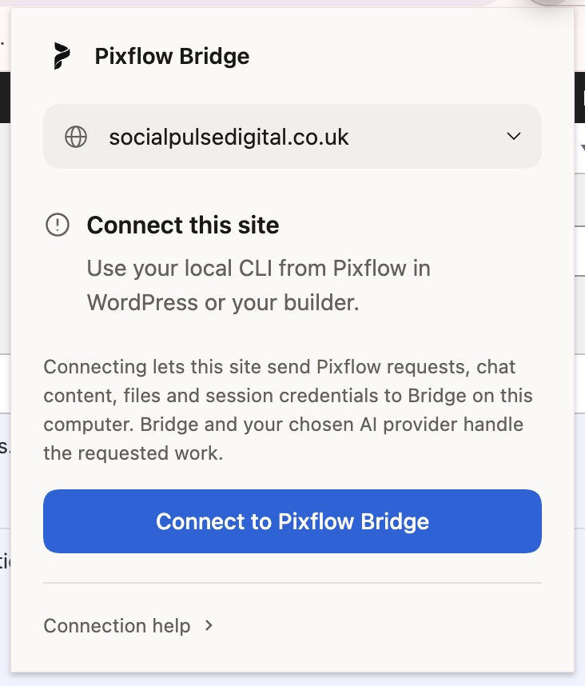
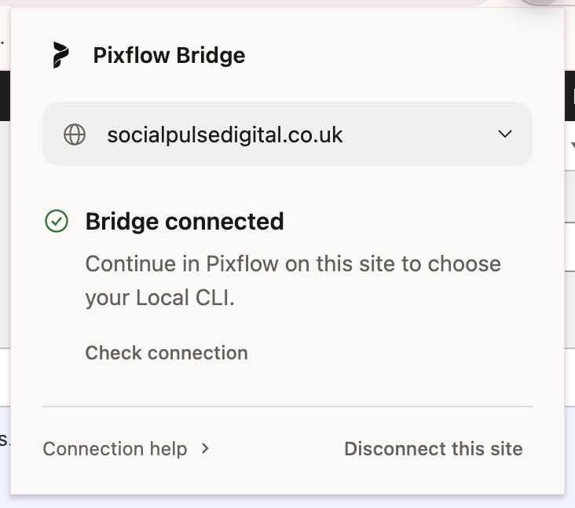
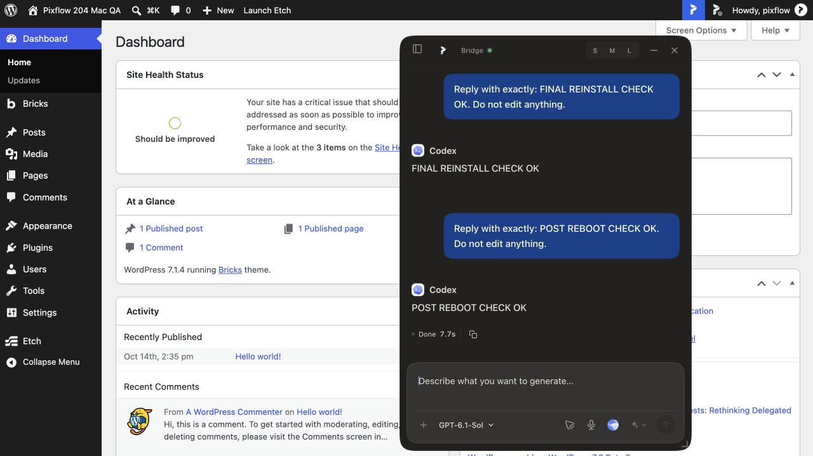

# Mac 2.1.1 production draft handoff

28 October 2026. Supersedes the older Mac acceptance summaries for release decisions. Installers are production-format **2.1.1 stable**, not RC. User authorized production builds and draft uploads and reported completing the remaining manual checks. Publication remains a separate step.

## Review and immutable source pair

| Repository | Source | Review |
| --- | --- | --- |
| Core | `72d4dee346fab1a564703c84a47c3d9ecd7825a6` | [Core #31](https://github.com/pixflowdev/pixflow-design/pull/31) |
| Private Pro | `4a61d59a289483b0e364673b529f392d04712642` | [Pro #19](https://github.com/pixflowdev/pixflow-design-pro/pull/19) |

Both implementation branches are `codex/mac211-queued-chat-switch`. Pro pins this exact Core revision, module API 14. These PRs are based on the combined candidate [Core #30](https://github.com/pixflowdev/pixflow-design/pull/30) and [Pro #18](https://github.com/pixflowdev/pixflow-design-pro/pull/18). Review the dependency chain before merging; no PR was merged by this work. Documentation commits on this receipt branch do not change the build pin.

Changes: prevent queued dispatch during a pending floating-chat selection; carry that guard into Pro's Bricks composer; fix transparent header menu button and token-scope wrapper backgrounds. Existing deferred selection remains: a queue stays with its original chat and drains when that chat is reopened. This does not add background queue execution while another chat is selected.

## Validation

- Core guard/full typecheck/native typecheck; native 53 passed, one Windows-only skip; packaged 22 passed; packaging three passed. Queue regression failed on the frozen integration candidate, then passed; 51 focused queue/conversation/preparation tests passed.
- Paired Pro guard/typecheck/build contracts/PHP passed. Full paired browser suite: 2,220 passed, 28 skipped.
- Exact Core CI passed ([run](https://github.com/pixflowdev/pixflow-design/actions/runs/40759052988)). Exact Pro CI passed on attempt 2 ([run](https://github.com/pixflowdev/pixflow-design-pro/actions/runs/40758103291)). Attempt 1 failed fetching Core before its push completed (`not our ref`), before tests; rerun required no source change.
- Observed live: floating queue automatic delivery and chat-switch recovery; Workspace steering/chat switch/reload with unique saved replies; draft ownership; fresh-tab last-active restoration; Etch response/list markers/drawer selection; header visual/computed CSS; permission revocation error without replay; restoration and direct fallback in both panels.
- Two approved sites: QA candidate and `socialpulsedigital.co.uk` with installed Core/Pro 2.1.0. Extension discovered the second site before Bridge pairing. Distinct Bridge databases; QA request completed in QA only; second-site history and existing draft remained separate. No live second-site plugin update or content edit.
- Repair/uninstall/reinstall preserved all 44 recorded runtime file hashes; relocation and user-operated tray Restart passed.
- Full OS reboot confirmed. Chat/project/content tables were identical before/after, no runtime files missing; only SQLite shared-memory/WAL changed before the new run. WordPress differences were caches/cron/update state, admin audit/context authority and central entitlement refresh. Bridge did not launch at OS login. After manually launching the installed candidate, Chrome automatically reconnected with popup closed and no Reconnect click. Fresh request completed in 4.1 seconds.
- Bricks manual design route opened a preview when available, was absent when unavailable, and stale-menu activation fell back to Design Systems settings. No profile was saved. Temporary Bricks settings/route fixtures were restored.
- User reported the remaining manual checks complete. Attachments/context ownership, explicit-link/logout-login restoration and multiword font-family checks are user-reported completion, without itemized evidence; do not describe these as independently observed passes.

## Production artifacts and installed smoke

Fresh clean output, `--portable`, Pixflow Design Bridge identity, version 2.1.1. Ordinary build had native payload unset; optional build has permanent extension identity `hbnbiboohlelmngadeolikeejamjlbkh` (extension 1.0.2). The ordinary DMG passed through the Bridge installer recipe's `--arm64` import path after a fresh portable tools-pack build; no QA DMG was relabelled. Optional artifact has a separate name.

Both passed `codesign --verify --deep --strict`: **ad-hoc signatures only, no Apple Developer ID or notarization**. Ordinary installed/launch/health and live CLI request passed (5.5 seconds). Optional installed/launch/host registration passed; Chrome launched its production native helper and QA reconnected after reload with popup closed. Configs contain no build-machine runtime roots.

| Asset | Bytes | SHA256 |
| --- | ---: | --- |
| `pixflow-design-bridge-2.1.1-mac-arm64.dmg` | 209953793 | `ad45372f28b618d5bc2d411714676711f44b35aa8cbb711894d1f7ff1f85f6a6` |
| `pixflow-design-bridge-2.1.1-mac-arm64-browser-native.dmg` | 209950752 | `857d9687fb118fd7d5d8791ee2c239c791392e26f04fd00004140667bd5eccbe` |

Draft destination: [Core draft release](https://github.com/pixflowdev/pixflow-design/releases/tag/untagged-2da3790fffeb3da16b64), release ID **427088978**, tag **bridge-v2.1.1**. All four assets are uploaded. [Upload receipt](evidence/mac211-production/uploaded-assets.json) lists final asset IDs, sizes and server digests. Each GitHub digest matches its local SHA256; [verified release metadata](evidence/mac211-production/verified-draft.json) confirms `draft: true`, `prerelease: false`. Only the two public Bridge DMGs, checksums and redacted acceptance receipt belong there. Private Pro ZIP/source stays private.

## Windows agent next steps

Review Core #31 / Pro #19 and their integration dependencies; use the exact pair above for reproducibility. Check the draft assets and receipts before your production Windows work. These are Apple Silicon builds only: Intel macOS and Linux were not built or accepted here. Apple signing/notarization remains absent. The older unexplained provider delay is not claimed fixed. OS login auto-launch is not enabled in this fixture; site reconnection is automatic once Bridge is running.

No release publication, updater pointer, website download, Store submission, checkout, live plugin deployment or repository visibility change was made. Draft staging is not final deployment approval. Rebuild/revalidate if review changes shipped code.

Evidence: [redacted build receipt](evidence/mac211-production/mac-2.1.1-build-acceptance.json), [checksums](evidence/mac211-production/SHA256SUMS-mac-2.1.1.txt), [reboot preservation](evidence/mac211-production/reboot-preservation.json).

Header CSS evidence on the current installed candidate (historical chat content visible; this image is not the final reboot result):

