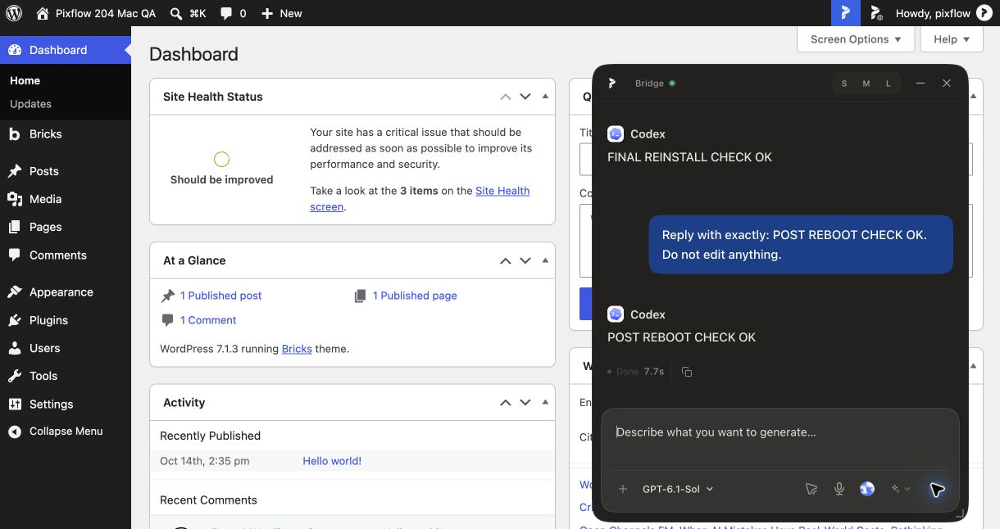
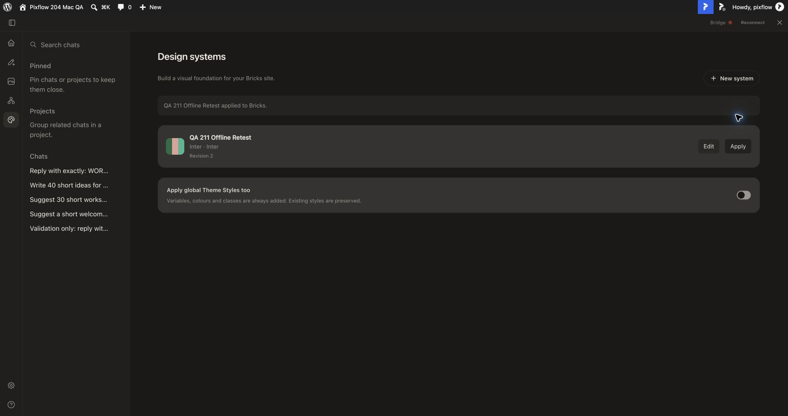
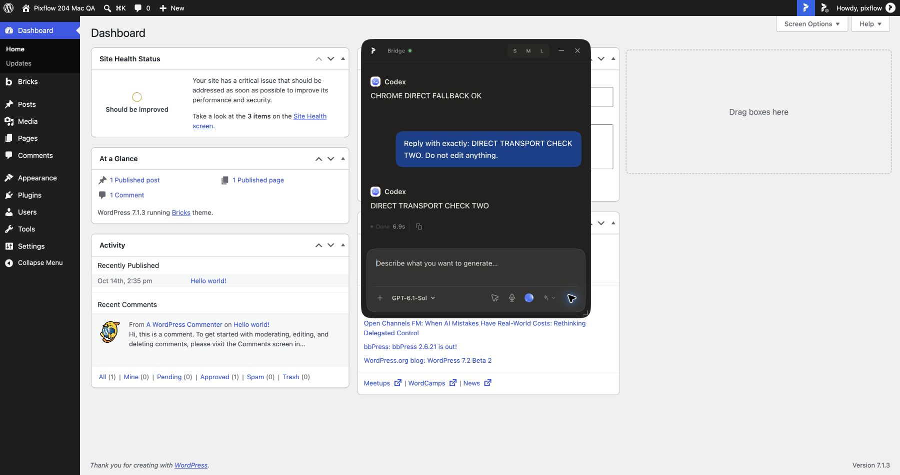
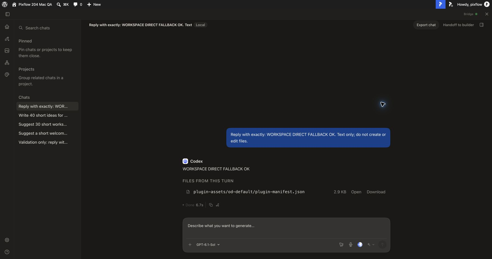
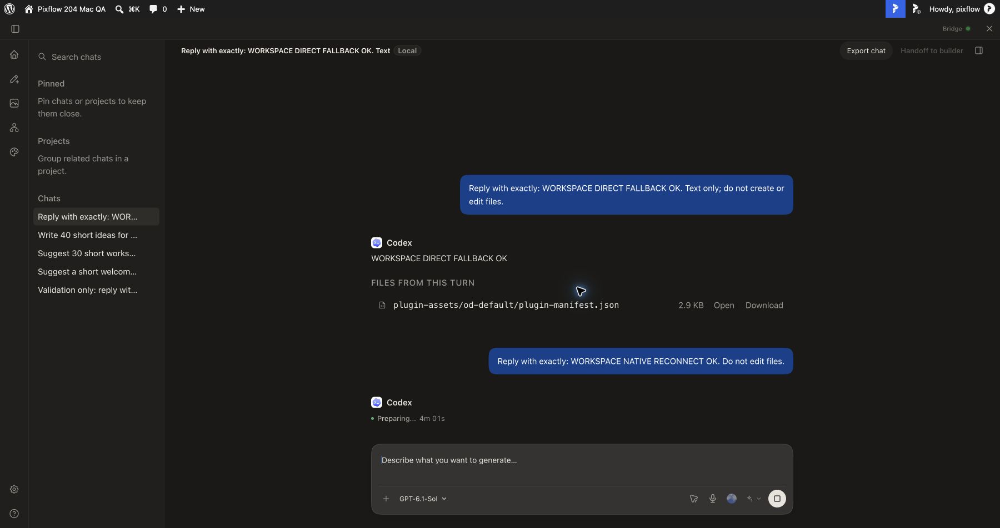

# macOS 2.1.1 retest receipt — 28 October 2026

**Partial acceptance; not release approval.** This supersedes the earlier receipt for the new candidate only. No release assets were uploaded, no Store certification submitted, and no merge or updater change was made.

## Inputs and scope

- Core `dbe241f6bfbdd544978cb9eef6c41a73dd34ec36`; private Pro `398cf34e30ecbbdbf1b98293461657f09b0d9c51`.
- Handoff `90026cc2be74868ef524cd77e66beb6851204013`, branch `codex/release211-mac-acceptance`.
- macOS 26.5.1 arm64; Chrome 156.0.8078.48; Node 24.19.0; pnpm 10.33.2.
- Authorized original trusted LocalWP QA site; Free and Pro 2.1.1 remain active. Database, wp-content and prior runtime data were backed up locally.
- Ordinary and optional-extension DMGs built separately, product `Pixflow Design Bridge`, ID `dev.pixflow.bridge`. Existing system Applications installation was not replaced.
- Exact-ID unpacked Chrome test extension: `hbnbiboohlelmngadeolikeejamjlbkh`. Private Pro supplied public identity instructions; Store build remained keyless. The user loaded it in their named Chrome profile, not a verified fresh disposable profile. The user also independently connected/tested the in-app browser.

## Post-reboot discovery finding

The user reported an empty Chrome extension Website dropdown while Bridge was running. Both health and `/api/pixflow/site-context` returned `site:null`. In `native-messaging/src/enrollment.ts`, discovery returns an empty site list without an active site key/origin, and `popup.ts` fills its dropdown from that list. Clicking **Reconnect** in the Chrome WordPress panel restored the QA origin and a fresh text-only request completed in 7.7 seconds. Prior chat history remained visible. Popup recovery still awaits user visual confirmation; this is manual recovery, not automatic reconnect acceptance. No transport capture was taken for the fresh request.

## Automated checks

| Check | Result |
|---|---|
| Core guard / full typecheck | PASS |
| Codex / gateway / registration / queue | PASS: 19 / 18 / 4 / 33 tests |
| Native transport / native typecheck | PASS: 44 tests, one Windows-only skip / PASS |
| Packaging integration | PASS: 3 tests |
| Pro setup / guard / typecheck / contracts | PASS; 3 contract tests |
| Free and Pro ZIPs, ordinary and extension DMGs | PASS |
| Pro archive integrity / shipped replay | PASS: 2 tests |
| Complete paired web suite | FAIL: 2,215 passed, 1 failed, 28 skipped |
| Complete paired PHP suite | FAIL: one remaining script |

Full remaining assertions are attached as `web-failure.txt` and `php-failure.txt`. Web: `tests/bricks/bricksMcpSkills.test.ts:1278` expects quoted `"SF Mono", monospace`, but Mac output is `SF Mono, monospace`. The platform-specific fallback selection/materialization path in `tools/pixflow-design-bridge/bricks-handoff-cli.mjs` needs review together with serialization. This receipt does not weaken the assertion or claim a rendered-font regression solely from quoting.

PHP: Pro's `wordpress/tests/direct-site-workspace.test.php:4` still constructs its fixture under uncanonicalized `sys_get_temp_dir()`. On Mac, `/var` is a symlink; PrivateDirectory rejects the ancestor at line 92. The same test passes with a canonical TMPDIR. Production symlink protection was not changed. The default full-suite failure remains a gate.

## Live results

| Scenario | Result |
|---|---|
| Direct long steering, successor and reload | PASS: original 1m08s, guidance 2m04s, automatic successor 7.3s. Reload during delivery reconciled the durable receipt. No manual Send for successor; no observed 25-second 504. Reload prevented capture of the original POST's final status, so no direct HTTP-200 claim is made. |
| Workspace bounded long steering | PASS: POST returned 200 with state `queued` after the bounded wait; original completed 2m42s, guidance started through normal queue and completed 8.3s. |
| Workspace automatic successor | DISPATCH PASS, latency finding: automatically started, completed 7m17s. See timing diagnosis below. |
| Stop preserves pause | PASS: current run canceled; queued synthetic item retained with explicit Resume/Send state. It remains paused. |
| Manual styling while Bridge stopped | PASS: Use site styles / Custom styling / Change site design system are usable. |
| Offline reusable design profile | PASS: saved revision 2 with primary #246B45; reopened after reload while Bridge disconnected; applied to Bricks with success confirmation. Persisted variables/palette/style manager contained test colour. |
| Restore manual test settings | PASS: eight scoped Bricks options restored to pre-retest values/absence; saved synthetic profile retained. |
| Chrome actual optional prompt and initial native request | PASS: user clicked Allow; expected native process observed; response 6.8s. Initial capture had page requests but no loopback requests. |
| Chrome reload | Functional PASS: saved history and new reply 6.2s. A second initial marker was the user's separate in-app-browser submission, not replay. |
| Extension disabled, direct fallback | PASS: reply 6.9s; captured normal loopback POST `/api/pixflow/direct-site/run-stream`. |
| Extension disabled, Workspace fallback | PASS: reply 6.7s; captured loopback POST `/api/runs` and event stream. |
| Reapproval / native Workspace request | PARTIAL: user reconnected; 23 page requests and no loopback requests; backend run and Codex session began. Request remained Preparing and was used for interruption test. |
| Disconnect during active Workspace request | FAIL visible recovery: after user clicked popup Disconnect, UI continued Preparing; explicit Stop canceled at 4m01s. Runtime contains only one run for this request, so no duplicate dispatch was observed. Removing Chrome host permission itself was not separately exercised. |
| Native authorization | PASS at installed native-host boundary: invalid WordPress direct session rejected (400 stream with explicit authorization denial); unapproved site rejected; wrong extension origin exited 1 with no frames. Not a substitute for expired-login browser UX. |
| Ordinary / extension uninstall-reinstall | PASS: 33/33 and 17/17 runtime files respectively byte-identical before restart. No remove-data flags used. |
| Fresh direct request after reinstall and restored relocation | PASS: FINAL REINSTALL CHECK OK, 5.5s; old history retained. |
| Native owned unregister / launch repair | PASS: manifest removed by owned helper; normal launch restored exact origin and persistent launcher. |
| Real tray Restart | PASS user-assisted: user selected Restart; app PID changed 16816→17058, healthy 2.1.1 gateway returned. Site needed Reconnect. |
| Relocation | PASS within isolated tools-pack root: moved root, launched successfully, native launcher updated to relocated executable; original path restored. Not Finder drag-install coverage. |
| Signature | PASS verification; ad-hoc, no Developer ID/notarization acceptance. |
| Reboot | PARTIAL: OS reboot confirmed (15:28:42 UTC). Manual isolated Bridge launch, retained chat history, WordPress Reconnect and fresh Chrome reply PASS (7.7s). Before Reconnect, healthy Bridge returned `site:null`; user reported empty extension Website dropdown. Automatic site recovery not passed. |
| Published installer upgrade / x64 / Linux | NOT RUN; no corresponding fixture/architecture was validated. |
| Bricks-to-WP/ACF handoff, review targeting, full stalled-canvas recovery | NOT RUN as complete original-matrix scenarios. Prior native save/reload checks do not substitute. |

## Findings and follow-up for coordinating agent

1. **Active native Workspace disconnect does not promptly settle the UI.** Repro: connect exact-ID extension, send a Workspace request, disconnect in popup while Preparing. UI remained Preparing until explicit Stop at 241.7 seconds. One backend run existed, with session-start event but no response text. Investigate how native stream cancellation interacts with Workspace event recovery and whether reconnect to an existing run is intentional; make the visible state explicit and avoid replay. Browser event capture was interrupted by a turn boundary, so the receipt does not claim absence of all recovery network traffic.
2. **Long Workspace latency is after dispatch.** For the 437.424-second queued successor, run pipeline began at 0ms, Codex session arrived at 76ms, first text at approximately 437280ms, and process exited successfully. Queue dispatch itself did not wait seven minutes. A later native Workspace request also reached a provider session and stalled before being intentionally stopped. Provider/adapter cause is not established by available logs. Redacted timeline attached.
3. **Two Mac automated gates remain red**, with complete diagnostics and fixture/serialization leads above. Keep the immutable tested pair; fixes require a new reviewed pairing and rerun.
4. Earlier generic Design Your System UI displayed “Could not load Pixflow Design System.” The current Bricks library/editor route completed offline save/reload/apply; treat the earlier adjacent route warning separately rather than claiming every design-system entry point is cleared.

## Preservation and final state

All 12 original posts, all comments and users remain unchanged. All nine original postmeta rows remain; only the synthetic page's edit-lock timestamp changed. All four original projects remain; two synthetic test projects have updated timestamps, and one new synthetic fallback chat was added. The eight test-modified Bricks options are restored. No draft was published. Raw database, licence, credential, runtime and browser data stay local and are excluded from Git.

The optional-extension candidate is running from the original isolated path; ordinary is stopped. Chrome's QA extension connection is disabled after interruption testing; direct fallback remains available. The saved profile and clearly labelled synthetic test chats remain for reproduction. The queued Stop test remains paused.

## Artifact checksums

These are local candidate builds, not approved or published release assets.

| File | Bytes | SHA256 |
|---|---:|---|
| `pixflow-ai-2.1.1.zip` | 2378136 | `887cab3f1387a316e5ae9ef869bd65d253a6c4d4c8d03b67fd382319eb351bd6` |
| `pixflow-design-bridge-2.1.1-extension-mac-arm64.dmg` | 209942166 | `2a56c9383b80f531fa223316cc0b2cbe509d04f8fd2ffd6627893cef93878f8b` |
| `pixflow-design-bridge-2.1.1-ordinary-mac-arm64.dmg` | 209944332 | `e3807cfe63401cb24e7f04456169e30a4fd60996616b05e73f9fd6d3a2dd17d4` |
| `pixflow-design-pro-2.1.1.zip` | 5947850 | `14ff9a97dca28f8c0aac7dd680e390967c7a33b87d4566eb04bcce1dcfd56dc6` |

## Evidence

See adjacent JSON receipts for exact checksums, timing, preservation, registration/auth and lifecycle scope. Automatic post-reboot site recovery and unavailable original-matrix scenarios remain explicit gaps. Final CI/review, website/download/updater/changelog/language checks and accurate ad-hoc macOS disclosure remain promotion gates.
