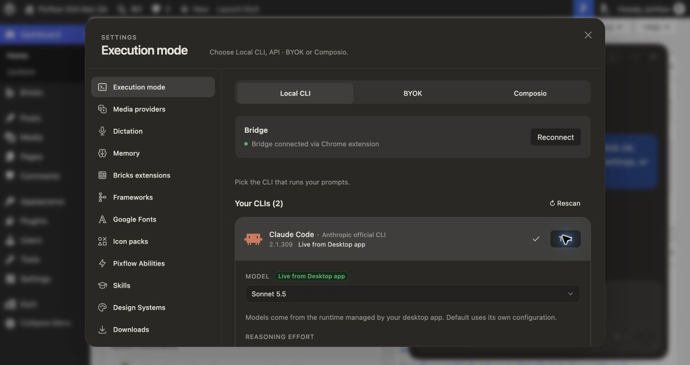

# Corrected Mac candidate — live acceptance in progress

29 October 2026. This updates the earlier blocked Mac report; it is **not release approval**.

## Source and environment

- Frozen Core: `6e13644ac17c8b97d451b0639b031f00d01093db`.
- Frozen Pro: `17b358fb11dcfdbab6e4f8e095c1a981b3dc497a`, API 14, exact Core pin checked.
- Both separate worktrees were clean at build and after generated WordPress assets were restored.
- macOS 26.5.1, Apple Silicon, Node 24.19.0, pnpm 10.33.2. Candidate app is arm64 Electron 44.7.0, isolated namespace `qa-claude-mac-103`, app version 2.1.1 for local acceptance only. No production DMG was built or uploaded.
- Claude Desktop 4.29.0; app-managed CLI 2.1.309, including the macOS `claude.app/Contents/MacOS/claude` layout. No installed runtime changed.
- Extension 1.0.3 frozen ZIP SHA256 `4750cbe937d5365c771c8ade9f5ebed7456d5841dee0101d977e8e3be2144839`, all ten payload hashes verified. Permanent ID `hbnbiboohlelmngadeolikeejamjlbkh` supplied by the existing public manifest key in a disposable unpacked copy.
- Owner loaded the extension into Ellie’s Chrome, which retained old approvals, then into Chris’s Chrome for the unapproved-site consent matrix. Chrome Details confirmed version 1.0.3, permanent ID and the intended test folder. The owner signed into QA without opening Pixflow or approving site access. The fresh QA permission flow subsequently passed with explicit owner approval.

## Automated gates

| Check | Result |
|---|---|
| Core guard, full typecheck, daemon build | PASS |
| Focused Claude runtime suites | PASS |
| Frozen native tests | 62 passed, 1 skipped |
| Reconnect tests | 7 passed |
| Focused Core web | 89 passed across 13 files |
| Pro guard, typecheck, build contracts | PASS |
| Full paired web | 2,224 passed, 28 skipped; 204 files passed, 2 skipped |
| Paired Bridge rerun | 18 passed, 1 skipped; POSIX synthetic launcher executed |
| Popup fix native tests | 64 passed, 1 skipped |
| Popup fix guard, full typecheck, Store browser build | PASS |

The first Bridge attempt refused a temporarily dirty Core pin while a simultaneous WordPress build generated assets. It was rerun clean without a pin bypass; the final result above is the actual completed suite.

## Live results so far

| Check | Result / limit |
|---|---|
| Previously approved QA site automatically connects | PASS: Chrome page and native candidate gateway, no toolbar Connect |
| Claude Desktop discovery and label | PASS: actual Execution UI says `Live from Desktop app`, 2.1.309 |
| Fresh isolated sign-in, waiting, Cancel, retry | PASS: actual Execution button; owner completed official authentication; isolated CLI reports logged in |
| Automatic post-login card refresh without manual rescan | NOT YET ACCEPTED: a test-only daemon config override was overwritten by the existing browser config. After reloading with the override present before hydration, the correct account was recognized. Repeat a fresh attempt with consistent fixture state before claiming this gate |
| Model/effort capability | PASS: authenticated catalogue includes Sonnet 5.5 and Haiku 4.5; Haiku 4.5 hides effort, Sonnet 5.5 offers Low through Max. Sonnet 5.5/Low remained selected after navigation/reload |
| Provider Test over native extension | PASS: `Claude Code replied in 2869 ms — 'ok'` |
| Floating Claude no-change request | PASS: exact requested text, 13 seconds, 15 output tokens, no dollar estimate |
| Workspace Claude no-change request | PASS: 25 fictional names, 8.8 seconds, 252 output tokens, no dollar estimate. Workspace lists its bootstrap plugin manifest as a generated artifact; no site-content edit requested |
| Popup health with two approved sites | FAIL on frozen 1.0.3; PASS after this branch’s browser fix and owner-approved reload |
| Execution / floating / Workspace reconnect | PASS separately: each opens the native extension popup from the actual foreground UI. Background automation is correctly rejected by the focused-tab guard |
| Popup Close and direct preference | PASS: closing without Connect leaves direct route; explicit Disconnect changes Execution/popover wording to direct |
| Codex Workspace streaming, live steering and cancel | PASS: Steer delivered during stream, subsequent names followed flower instruction, Stop produced Canceled at 44s |
| Claude navigation recovery | PASS: page reloaded during active Workspace run; returning showed one completed response, 32s / 3,138 output tokens |
| Actual Claude process model/effort | PASS: `--model sonnet --effort low`; redacted metadata in `claude-active-runtime.json` |
| Authenticated runtime catalogue | PASS: full runtime result saved in `authenticated-catalogue.json`, UI choices matched observed names/capabilities |
| Representative direct provider requests | PASS: Claude Workspace exact response in 8.7s / 15 output tokens; Codex floating exact response in 4.7s |
| Codex floating native request after browser restart | PASS: exact requested synthetic response, Done 10s |
| Claude floating streaming/completion and Stop | PASS: 100-name no-change response completed at 41s / 3,246 output tokens. A separate longer response was stopped during streaming and displayed Canceled at 18s. The first completion raced the Stop click and is not counted as cancellation evidence |
| Claude floating live steering | NOT SUPPORTED in this candidate: queued instruction had no Steer control while streaming. `WpAdminAgentFrameApp.tsx` enables it only for Codex/OpenCode, and `apps/daemon/src/pixflow/direct-site-routes.ts` rejects other agents. The synthetic queued instruction was removed before it ran. This does not satisfy the handoff's Claude steering requirement; changing only the button would be incorrect |
| Full restart/revoke/steering/cancel matrix across both panels | INCOMPLETE on this candidate; older v2.1.1 evidence does not substitute |
| Standalone fallback | NOT RUN: no standalone binary found at usual existing install locations; no runtime installed/removed merely to pass |
| Unapproved-site discovery and Execution entry point in Chris’s Chrome | PASS: foreground Execution Reconnect opened `Connect this site`; Website already listed QA before approval. WordPress retained its direct route |
| Fresh QA permission completion | PASS: owner approved the action; Chrome requested access only to QA; Allow completed and popup reported `Bridge connected` |
| Reload and new-tab automatic native route in Chris’s Chrome | PASS: popup closed, no Reconnect click; Execution reported `Bridge connected via Chrome extension` in both cases |
| Bridge restart with Chris’s popup closed | PASS: namespaced packaged stop produced `Bridge disconnected`; packaged start initially had no active site; background recovery restored QA and Execution reported extension route without opening popup or clicking Reconnect. Transient other-site message was observed during recovery; no exact recovery duration asserted |
| Browser restart in Chris’s Chrome | PASS: owner quit Chrome completely, reopened Chris and QA without popup/Reconnect; Execution reported `Bridge connected via Chrome extension` before any popup interaction |
| Foreign/subframe live cases | NOT RUN; deterministic coverage passed |

## Popup defect and fix

A live Claude request succeeded while the popup said `Bridge not reachable`. A fresh native-host health request reproduced `Native adapter rejected the site, destination, method or headers` for the QA origin when the other approved site was active.

The popup enrolled on one native connection, closed it, then probed on a new connection. Native authorization is process-local; discovery initialized the new process from the globally active site. The fix enrolls the already-approved selected site on the probe’s own port before GET `/api/health`. It keeps permission checks, exact-origin checks, timeout, and disconnect cleanup. No page receives native enrollment authority.

`native-status.test.ts` reproduces the failure on the frozen candidate and the fetched `origin/main` implementation. The new same-port enrollment test is green on this branch, with refusal/timeout/mismatched-origin coverage. Live popup changed to `Bridge connected` after loading only the rebuilt test `background.js`. The frozen ZIP remains unchanged and needs a newly frozen replacement before release.

Native popup screenshots are retained locally pending privacy review because they include browser chrome outside the test page. Do not upload those unredacted captures.

## Preservation and remaining work

Full QA database/plugin and native-registration backups exist locally, outside Git. Synthetic chat additions are intentional. Test-only Claude auth preference is currently retained for continuing acceptance; restore it when the run is complete. Normal Claude authentication was not logged out. A second previously approved site enrolled automatically, but no prompt/content mutation was sent there.

Complete the remaining live gates and backup reconciliation, then return acceptance to the coordinator. Final production DMGs require a new version/source pair: do not overwrite released 2.1.1 or publish Store/release/updater changes. Earlier Core #42, Pro #23/#24 and report #43 remain provenance for the corrected candidate.
