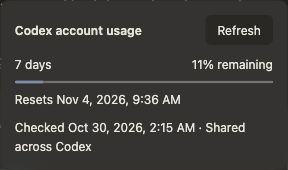

# Mac provider-usage acceptance and production 2.1.3 builds

30 October 2026. Targeted scope authorized by `codex/mac213-usage-handoff` at `6c81f4d3c930408dcdafd378b50c85e63afe8d4e`. Broad 2.1.2 acceptance is reused; no new builder, steering, authentication, permission or installer campaign was required.

## Immutable source

Acceptance baseline: Core `2568c45cdb5a2263f3bb0784b9b4b11342475143`, Pro `0f0e73e03d90b8518817a45db7dd285a39af3ec5`, API 14. Both candidate plugin ZIPs were built and installed on the existing QA site, retaining data. The candidate Bridge was copied to a persistent isolated installation and launched from that installed copy before usage UI checks. Acceptance app version 2.1.2; release builds below are 2.1.3.

Final production source: Core `c9d1481944e5020c2b82e48b54754b5c811b8a24`, Pro `fc7c469f7d765a78077181bc4ec958508d63b310`, with the exact Core pin enforced. Preparation changed release versions/readmes and the Pro pin only. No implementation fix was required. [Core PR #56](https://github.com/pixflowdev/pixflow-design/pull/56), [Pro PR #31](https://github.com/pixflowdev/pixflow-design-pro/pull/31). Independent Core #50/#51 and Pro #28 were not added to this pair; coordinator reconciliation remains necessary before promotion if additional payload changes are desired.

## Targeted results

| Check | Result |
|---|---|
| Focused backend usage tests | PASS: 22 |
| Focused usage UI tests | PASS: 10 |
| Core/Pro guard and full typecheck | PASS |
| Paired build contracts | PASS: 3 |
| Native health/reconnect regression checks | PASS: 9 |
| Provider source | PASS: both report Live from Desktop app; Codex 0.165.0-alpha.1.2, Claude 2.1.309 |
| Codex live allowance | PASS: one weekly window, 11% remaining, reset Nov 4 2026 09:36 local; matches runtime result. No fabricated five-hour window |
| Claude live allowance | PASS: shared five-hour 0% remaining, weekly 91%; UI ring correctly uses constrained 0%. Runtime returned the same shared limits for Sonnet and Opus |
| Model switch and reload | PASS: Sonnet 5.5 to Opus 5.5 persisted on reload, queries refreshed; shared windows remained identical. Sonnet choice subsequently restored |
| Model-specific windows | Not supplied by this account; deterministic fixture coverage passed. No live claim of separate buckets |
| Floating and Workspace popup click/Refresh/Escape/close | PASS: live UI, both providers. Themed background/text and compact rounded popup retained; no large Workspace offset |
| Hover | PASS: owner manually verified both composers; browser automation exposed no hover action |
| Anchor/clipping | PASS: measured active popup gap 8px. Workspace inspected at 600px viewport with popup fully visible; viewport override reset |
| Temporary unavailable and recovery | PASS: stopped isolated candidate, Refresh showed Unavailable, never 100%; restarted and live allowance recovered. No permissions or credentials deleted |
| Existing CLI fallback | PASS: isolated read through existing Codex CLI returned available weekly allowance, source cli. Process-scoped discovery override ended; Desktop preference retained. No standalone Claude CLI installed, so its conditional fallback check was not applicable |
| Preservation | PASS: posts/postmeta/comments/taxonomies and existing chat message tables unchanged. No model turn generated. Original Codex provider/model and saved Sonnet/Low choices restored |

Claude initially required CLI authentication. The owner completed the official sign-in; the Execution card automatically refreshed to the Desktop runtime. This was a prerequisite sign-in, not a repeat of the old authentication matrix. No credentials or tokens were copied into other clients or committed.

Core packaging generated tracked browser/language assets temporarily; these generated changes were restored before Pro's clean exact-pin build. Pro's required pinned detector was prepared through its documented adapter from Impeccable commit `374a0e179bb36725283a612462131705ba4780ae`. No pin bypass or runtime scope expansion was used.

Private full-page screenshots, plugin backups and database snapshots remain local outside Git. Redacted runtime snapshots contain window metadata only. Build/upload receipts below distinguish Rosetta from physical Intel and ad-hoc signing from notarization.

## Production outputs

Both production 2.1.3 DMGs passed `hdiutil verify`, identity/version, portable configuration and native-helper inclusion checks. All 18 Mach-O binaries per bundle have the expected architecture; strict/deep ad-hoc signature verification passed. Neither bundle is notarized. Intel was built under Rosetta on Apple Silicon. The normal extension and its permissions were unchanged; no extension ZIP is included in this release.

[GitHub draft bridge-v2.1.3](https://github.com/pixflowdev/pixflow-design/releases/tag/untagged-f4d836cdad855d89c7a3), release ID `428584804`. See the [source/build receipt](mac-2.1.3-build-receipt.json) and [SHA256SUMS](SHA256SUMS-mac-2.1.3.txt). Final asset IDs and upload/download verification will be recorded in the upload receipt. No published assets, customer endpoints or updater pointers were changed.
