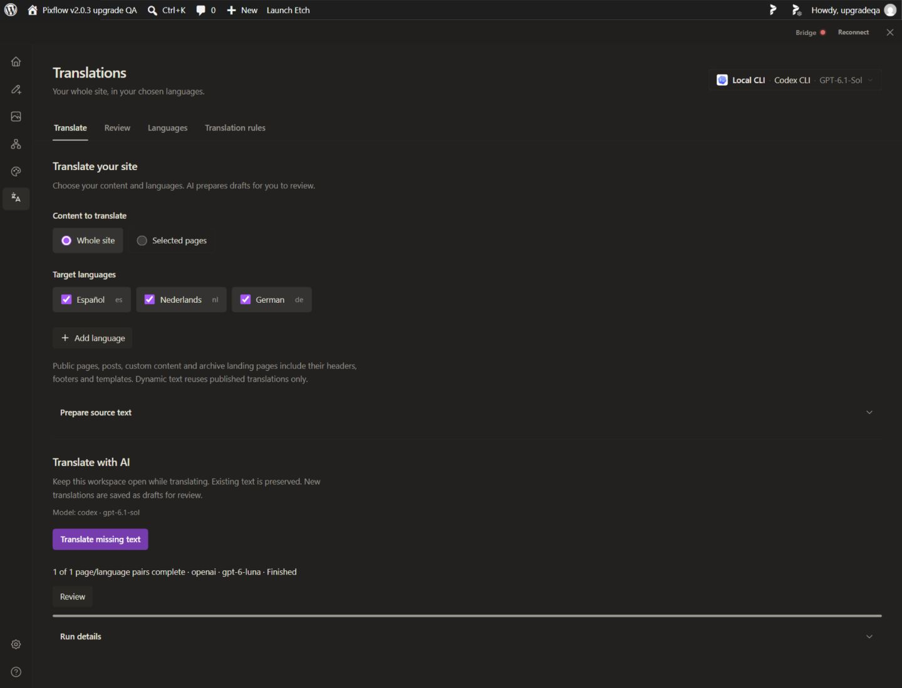

# Shared translations interface and switching checks

This branch supports the separately installed Pro translations preview. Core contains shared DTOs, routing/navigation seams, locale messages, an authenticated text-only Bridge primitive and `od` clients. The translation workspace, storage, generation jobs, publishing, rendering, SEO and runtime authorization remain owned by Pro. No Free translation endpoint or entitlement bypass is introduced.

`od agent-text --help` describes the bounded local text operation. `od site-translations --help` describes WordPress list/read/configure/capture/save/url/publish/prepare/updates and job operations. Private authentication headers and long JSON inputs are supplied through files; WordPress enforces the same permissions used by the UI. Anonymous source reads do not receive those headers. Do not commit header files or provider credentials.

## Validation

- Core guard and full typecheck pass.
- Daemon text validation/authorization/concurrency and CLI tests: 11 passed.
- Workspace hydration, provider picker, sidebar and sanitized configuration publication: 40 passed, 23 pre-existing AMR cases skipped.
- Cold API-to-CLI host status test and WordPress asset-mode checks pass.
- All 19 UI locale dictionaries pass consistency checks.
- Installed API/Codex/Claude generation, page navigation, saved drafts and provider synchronization across Bricks, Etch, Elementor and Gutenberg are recorded in the paired Pro acceptance reports.
- Initial hydration, picker, asset-enqueue and missing publisher regressions were reproduced before their fixes; see Pro's `docs/site-translations-phase2-checks.txt`. The newly consolidated CLI suite uses the daemon's standard Vitest runner.

The screenshot is the local preview, showing the shared rail, hidden chat sidebar and provider picker. The translation screen itself is supplied by Pro.

Merge Core first, then review the paired Pro pin against the accepted Core commit. The preview flag remains explicit. No version bump, language-pack publication, ZIP, installer, updater or live-site change is part of this PR.
